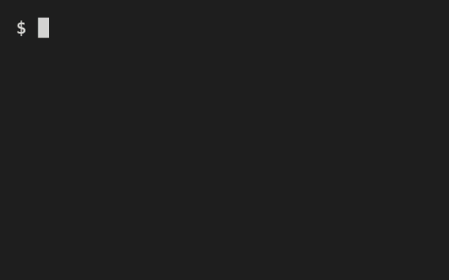

# codex-claude-quotabar

See your **Codex** and **Claude Code** usage limits in the terminal.



## Install

```sh
curl -fsSL https://raw.githubusercontent.com/c-xiong/codex-claude-quotabar/main/install.sh | sh
```

## Run

```sh
quotabar
```

No API keys needed — it uses your existing `codex` and `claude` logins. Works on macOS and Linux.

The background is transparent, so it blends into your terminal theme. Colors follow macOS light/dark mode. If your terminal doesn't match, set `export QUOTABAR_THEME=dark` (or `light`).

---

Uninstall: `rm -rf ~/.local/share/quotabar ~/.local/bin/quotabar`

Powered by [CodexBar](https://github.com/steipete/CodexBar). MIT License.
